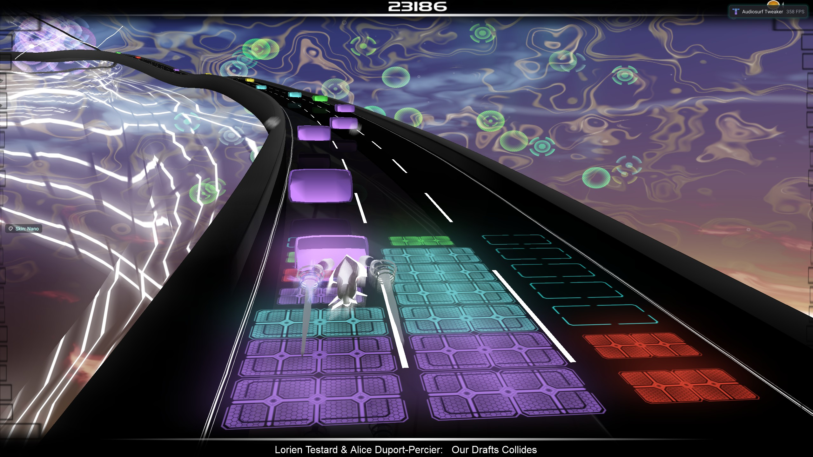
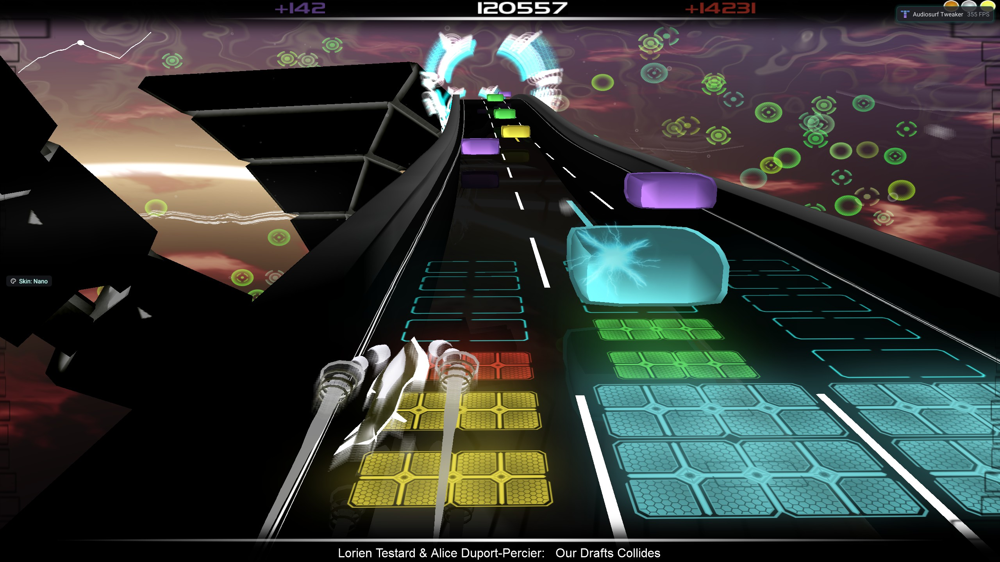
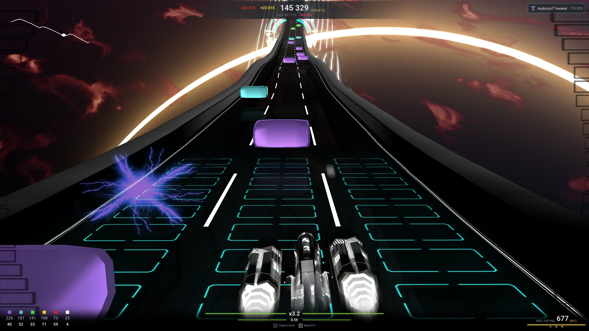

# Playing Audiosurf: the game from the player's seat

> **Draft** — written from interviews with the Tweaker's author (3 120 hours of Audiosurf) and checked against the
> game's graph with CgrPy; a review by another seasoned player is still to come. **verify** marks what is still from
> memory alone; **not mapped yet** marks what is known to the player but not yet found in the graph.

The rest of the internals manuals describe the game as its engine sees it: groups, channels, tables. This page
describes it as a **player** sees it — the screens, the rules, the characters and the words people use — and ties
each of those to the place in the graph where it lives. It exists so that a request like *"make Eraser Elite's
undo push blocks with overflow"* can be turned into *"which channels, which handler, is it possible"* without
guessing what the words mean.

## From launch to a run

| Screen | What the player sees and does | In the graph |
|---|---|---|
| Loading | The game's own progress bar, then a **Continue** button. | boot, see [lifecycle](lifecycle.md) |
| Main menu | **Play**, **About**, **Exit**. | `StartupState == State_MainMenu` |
| Character screen | Picks a character in one of three rows: **Casual** ("easy"), **Pro** ("harder"), **Elite** ("hard"). A separate **Ironmode** checkbox makes it harder still. | `StartGroup::PlayerVehicleType`, `StartGroup::LeagueID`, `SavedConstants::ironmode?` |
| Song selector | Picks a song from their own music. | `State_SongSelector` |
| Preparation screen | The track's map, the score needed for each medal, and a **Play** button. | medal thresholds: `StartGroup::Bronze/Silver/GoldRequirement`; the screen itself — not mapped yet |
| The run | See [The screen during a run](#the-screen-during-a-run). | `State_Gameplay`; "is the player actually playing" is `StartupState == State_Gameplay` |
| Results | The leaderboard and the player's own result. Puzzle players also look at their bonuses. | `StatCollector::Feat String`, `PointsWithGridBonus`, `HighestMedalEarned` |

The very first launch also runs a **tutorial**: puzzle without abilities, showing how to collect blocks. It cannot
be started from the menu. In the graph it is the character `Do_InitialExperienceGuy` (`ThinTraffic?`).

## Characters

**Character and league are one choice for the player.** A character is a gameplay type in one of three leagues,
and the character screen shows the leagues as three rows. Each entry is its own `PlayerVehicleType` with its own
branch in `SpecialPurpose` ([gameplay map](gameplay-map.md)); the league is `LeagueID`, a property of the entry. The names below
are what the game shows; the branch is what the graph calls it.

| | Casual | Pro | Elite |
|---|---|---|---|
| **Mono** | Mono — `Do_EasyNinja` (17) | Mono Pro — `Do_NinjaPro` (11) | Mono Ninja — `Do_NinjaMono` (13) |
| **Pointman** | Pointman — `Do_PointmanCasual` (15) | Pointman Pro — `Do_Pointman` (0) | Pointman Elite — `Do_PointmanElite` (10) |
| **Double Vision** | Double Vision — `Do_DVCasual` (9) | Double Vision Pro — `Do_Cooperative` (1) | Double Vision Elite — `Do_DoubleVisionElite` (14) |
| **Eraser** | — | Eraser — `Do_EraserMedium` (4) | Eraser Elite — `EraserElite` (12) |
| **Pusher** | — | Pusher — `Do_Pusher` (3) | Pusher Elite — `PusherElite` (16) |
| **Vegas** | — | Vegas — `Do_Vegas` (2) | — |

Watch the names: the game's **Pointman Pro** is the graph's plain `Do_Pointman`, and its **Eraser** (a Pro
character) is `Do_EraserMedium`. Mono in the graph is **Ninja** throughout (`SpecialPurpose::Ninja?`).

The game also has `StartGroup::ChosenDifficulty`, which selects a different set of medal thresholds. It is **not**
a separate choice the player makes: the main menu sets it to 0 / 1 / 2. The graph also has a difficulty slider on the
pause screen (`XX_PauseScreen::Do_DifficultySlider`) and keys in `XX_gui` (#537, #539) that move it, but **the player
never sees a difficulty slider anywhere** — those are dead UI. As far as the player can tell, the value follows what
they selected and switched on.

### Abilities

Abilities are used with the **left and right mouse buttons** (LMB, RMB), duplicated on the **`<` and `>`** keys.
In the graph, LMB is `LMB || Player::LeftGamepadTrigger? || Z key || < key` — so **Z** and the gamepad's **left
trigger** are LMB too (**verify** the RMB equivalents). Apart from abilities, the player only steers.

| Type | Camp | LMB | RMB | In the graph |
|---|---|---|---|---|
| Mono | Mono | **Collect from all three lanes** at once | **Jump** over a few blocks — a way past a grey block when there is no time to change lane. Has a cooldown. | `Ninja?` |
| Pointman | Puzzle | **Push** the block just collected onto the memory stack instead of the board | **Pop** the top of the stack onto the board, into the column under the car | `Is_a_Pointman?`, buffer `DumptyScoopDown?` |
| Eraser | Puzzle | **Erase** (held): take every block of the colour just collected off the board into memory | **Undo**: put the memory back on the board | `Do_RunEraserAbility`: LMB held sets `ShatterStorming?` — "shatter" is the graph's name for erasing; RMB fires Undo. Effects in `Effects/EraserEffect` |
| Pusher | Puzzle | **Push** the block just collected into the column to the **left** of the car's | the same, to the **right**. From the outermost lane, a push the wrong way does nothing. | `ThrowTilesDirection` |
| Vegas | Puzzle | **Shuffle** the board at random | Fire the **power-up** Vegas generates by itself from time to time | `canShuffle?` |
| Double Vision | Puzzle | — | — | `useClone?` |

- **Mono's two abilities are off in Ironmode.**
- **Pointman's memory is a stack** (last in, first out): **1 / 3 / 4** blocks deep for Casual / Pro / Elite, and 1 in
  Portal mode (`SpecialPurpose` `MaxBufferSize` = ChannelSwitch #1525 → #1052 by `LeagueID`; the table is
  `PointmanBuffer`). The player remembered 2 / 3 / 4. Pointman Casual also has **hints** on SPACE: the game suggests
  which blocks to take, given what is on the board (`RunHinter?`).
- **Double Vision** is two cars: the **left** one on the keyboard (**A / D**), the **right** one on the mouse. They
  share **one board, 4 columns wide**, two columns each, and a match that **crosses the line between the two
  halves** scores extra: `CooperativeMatchMultiplier` **1.5 / 1.75 / 2.4** for Casual / Pro / Elite (the player
  remembers ×1.5 — the Casual value). The game meant it for two players; in practice it is the one mode played with
  both hands. Two scores on screen.

### Eraser in detail

Eraser is the character whose mechanics people ask about most, because of its history.

- **Erase** takes every block of the colour just collected off the board into memory. **Memory holds exactly one
  colour** — the last one erased:
  - erasing the **same** colour again **adds** to it: 5 red, then 7 more red, is 12 red in memory;
  - erasing a **different** colour **replaces** memory: what was there is gone.

  Memory is kept **per column**: each erased block is remembered in the column it came from, and a column of memory
  holds at most the board's height. So memory is at most **one full board**; once a column of memory is full, a
  further block overwrites its last slot. (`EraserEffect`: table `EraserUndo`, column `Clipboard`; `Do_AddToClipboard`
  #156 places a block at row *n* of its lane, capped at `NumBufferRows - 1`; erasing the same colour keeps the
  clipboard and only recounts it, a different colour clears it — `Do_LaunchErasers` #7.)
- **Undo** puts memory back **from the top down**: each block goes back into **the column it was erased from**, onto
  the free cells at its top, not into the place it came from (`Do_FireUndo` #162 → #192).
- **Today**, a block whose column has no free cell left is **not placed, and is lost**: after Undo the whole memory
  is cleared. That is the "cut down to the free cells" players know. The game then restarts the match timer
  (`Puzzle::Do_ResetMatchingTimer`).
- **Eraser Elite's eighth row** is conditional: its branch sets 8 rows only when
  `XX_OnlineHighScoresTable::EraserCorrectVersion?` is set — a flag from the online high-score code, presumably tied
  to the Eraser rules changes between versions.
- **In older versions** Undo laid out everything: *lay out what fits → find matches and burn them at once → lay out
  what is left → repeat until memory is empty*. Since erasing one colour accumulates, an Eraser could hoard the most
  valuable **red** blocks for a long time — erasing nothing but red — while building the chain on small cheap
  matches made on the board, then Undo one, two, three full
  3×8 boards of red and score absurdly. A request to "make Undo push with overflow and burn the matches straight
  away" is a request to bring that back. Today's memory holds at most one board, so bringing it back fully would
  also mean a larger memory.
- Between Erase and Undo there is a moment when the game counts blocks as **out of memory but not yet on the
  board**. It is a mechanic of the whole game, used mostly by Eraser: it lets two large single-colour masses swap
  places between memory and the board. The player has no name for it, and it is **not mapped yet**. (It is not
  "shatter": that is the graph's word for erasing itself.)

### Leagues

Within one type, Casual, Pro and Elite differ only in what every type shares:

| | Casual | Pro | Elite |
|---|---|---|---|
| Burn timer | shortest — near-instant to the player | — | longest, 0.8–1 s |
| Colours on the road (Puzzle) | 3: blue, yellow, red | 4: blue, purple, yellow, red | 5: purple, blue, green, yellow, red |
| The road | coloured by the music | coloured by the music | grey, fixed palette |
| Shoulder (without Ironmode) | yes | yes | no |

The burn timer is `SpecialPurpose::MatchCollectionTicks`, in 25ths of a second: 10 / 10 / 20 by league (0.4 /
0.4 / 0.8 s), with overrides per character (25 — one second — for Eraser Elite, 17 Mono Pro, 28 Mono Ninja, 50
Freeride) and per song tag. When a collection pass finds no match, the **chain** drops: to zero in Casual and
Elite, to half in Pro (`Puzzle::Do_GraduallyResetChain`).

**Board size** is 3 columns × 7 rows, except **Eraser and Pusher: 3 × 8** in both their leagues (`Do_Use8Rows`), and
**Double Vision: 4 columns** — 4 × 6 in Casual, 4 × 7 in Pro and Elite (`BufferRowCount` 6 / 7 / 7; the player
remembered 4 × 7 for all). A song tag can set the rows outright (`UseCustomBufferRows?`, `CustomBufferRows` read from
the title).

**Watch the word:** the graph calls the board the **buffer** — `Puzzle::NumBufferRows`,
`SpecialPurpose::BufferRowCount`. Pointman's memory is `PointmanBuffer`. Nothing named "buffer" is a memory buffer in
the programming sense.

The **shoulder** is two extra lanes, one on each side: no blocks and no board cells under them. A player drives onto
one with an overfilled board, or when they have simply lost track. Ironmode removes it (`PercentTimeOnShoulder` is
in the final stats).

## A run

The track is built from the song. The car drives itself; **the player only moves it between lanes** and picks
blocks up off the road. What happens to those blocks depends on which of two camps the character is in.

- **Mono** — "collect the coloured, dodge the grey". Every coloured block is the same colour as far as the game's
  logic is concerned — before the run, `Do_NinjaMagic` turns every block into either yellow or stone — so any
  coloured block matches any other. **Mono has the board too**, and matches, and the chain: collected blocks drop
  into it as in Puzzle, matches burn on the same kind of timer, and the chain is built and dropped the same way. What
  is different is only that there is nothing to sort — every coloured block fits — and how points come in
  ([Scoring](#scoring-as-players-think-of-it)).
  Grey blocks are obstacles; never hitting one earns **Stealth**.
- **Puzzle** — "combine colours into matches and score them". Collected blocks drop into the column of the
  **board** under the lane the car was in, and matches of one colour burn.

### What the music changes

- the **slope** of the track;
- the **speed** of the car, together with the slope;
- the **density** of the traffic;
- the **colours** of the scene, in Mono and in Casual and Pro Puzzle;
- **neon rings** around the track at the moments the analyser finds intense (second screenshot below;
  `Render_IndustrialTunnel::Do_RenderNeonRings`, textures `ring*`).

**Elite Puzzle** is the exception: the road turns **grey** and the blocks use a **fixed palette of five colours**.

### Themes

The game has **three backgrounds**: two dark (**black**, **grey**) and one light (**white**). On the white one part
of the HUD is recoloured — a white progress bar would vanish against it — and it has its own textures: the
`*_Whiteskin` minimap, `particles1.png`, `ring*.png` against `.jpg` for the dark ones ([texturing guide](../texturing.md)). In
the graph: `StartGroup::WhiteBackground?`.

### The board and what a match is

**The board is drawn on the road itself**, under the car: a column of cells under each lane (the coloured tiles
in the screenshots below; empty cells are outlines). It is `Puzzle::Puzzle_State`, a table with one row per cell;
cell `n` is column `n % colCount`, row `n / colCount`, row 0 at the bottom. Matches are found by the game's own
Lua script `Puzzle::FindMatches` (#235):

- a match is a group of cells **connected up, down, left or right** (not diagonally) that are the same colour;
- a **wild** block (`wildID`) joins a group of any colour and counts as one of its cells — to the player, it lets
  fewer blocks of a colour than the minimum make a match (two red and a wild are three). It can be part of several
  groups at once: instead of being removed with the first, it is used up a step at a time;
- **stone** blocks and empty cells never match;
- a group counts when it has at least **`matchedGroupCount`** cells — 3 normally, 8 in Mech mode;
- the same script either removes the matches or only marks them for drawing.

### Special blocks and power-ups

| Block | What it does | In the graph |
|---|---|---|
| **grey** (Mono) | An obstacle; hitting one loses Stealth. In the graph it is a **stone**. | `Puzzle::StoneColorID`; `PerfectNinjaRun?` |
| **white** (Puzzle) | Never matches. Scores **2000 points** when it reaches the bottom of the board, and only then burns. | in the graph the **same stone** as Mono's grey (`ColorID` 7): a coloured block recoloured by `Do_ReseteWhiteWildBlocks` on every run, so whites move between restarts |
| **wild** | Matches any colour. | `wildID` |
| **Paint** | Paints every block on the board its own colour. | `QuestionBoxOverlord::Do_Painter<Colour>` → `Puzzle::Do_SetTilesToColor` |
| **Multiplier** | A random multiplier for a while: **×2–×4**, and **×2–×7** for Vegas (the player remembered up to ×12). | `QuestionBoxOverlord::Do_BeginRealScoreMultiplier`: `MIN(cap, FLOOR(2 + RAND × range))`, cap/range 4/3, Vegas 7/6; `MultiplierTimer` |
| **Sort** | Sorts the board by itself, for as many matches as it can get. | `QuestionBoxOverlord::Do_ApplySort` → `SpecialPurpose::Do_Sort` |
| **Storm** | Two blocks of its own colour into every column, as far as there is room; a full column is skipped. | `QuestionBoxOverlord::Do_Storm<Colour>` → `GrenadeManager::Do_LaunchColorStorm` |
| **Wildstorm** | Three wild blocks into one column. In 3 120 hours of play the Tweaker's author has never seen it; it may exist in leagues they do not play. Treat it as possibly unreachable. | `QuestionBoxOverlord::Do_Wildstorm` → `GrenadeManager::Do_LaunchTripleWild` |

Power-ups lie on the road like blocks: a block on the road is turned into one (`TrafficCommander::Do_TurnCarIntoPainter`,
`…colorstorm`, `…wildstorm`), and they are re-placed on every run (`Do_ReseteWhiteWildBlocks`). Spawn chances are
`SpecialPurpose::Chance_Spawn*` and depend on the league. Vegas also makes its own.

**Colour numbers.** Wherever the graph stores a colour as a number, 0–4 are **purple, blue, green, yellow, red** —
red is 4 in `Do_StormRed` and `Do_PainterRed`, yellow and red are `[3]` and `[4]` in the end-of-run 95% tests.

**Much of what the graph has around power-ups is debris.** `FindJollyRoger` and its "candy cane / sword / hook /
skull" shapes, `FindPirateShapes` and the like are not in the game, or the names mean something unrelated. The same
is true of the game's logic in general: **a great many names are leftovers or arbitrary and say nothing about what
the thing does.** A name is a lead, never evidence — see [gameplay map](gameplay-map.md) on dead branches.

**"About to burn"** is visible: the matched tiles grow slightly, and a shrinking outline of an empty cell is drawn
over them (the burn timeout is drawn with the empty-cell part of `tiles.png`). Collection is not instant: the board
waits `SpecialPurpose::MatchCollectionTicks` ticks between collection passes, and the chain multiplier is whatever
survives a pass ([How Audiosurf is built](../scripting/game-model.md), `Puzzle`).

### How a run ends

- **Without Ironmode** — only when the song ends. **Overfilling** a column costs points and, outside Casual, the car.
  On screen the overfilled column has no matches all the way to its top cell and its tiles **blink** between the
  normal and an error texture. In the graph it is `Puzzle::Do_OverfillPunish` (#1148):
  - **Casual** (`Do_EasyPunish`): **5%** of the current score, and the camera shakes;
  - **Pro, Elite** (`Do_CombatPunish`): **10%** of the current score, and the car is **destroyed and respawns**
    (`Player::Do_DestroyPlayerCar`). Until it has fully respawned it is drawn **blinking as a wireframe** of its own
    model and cannot pick anything up — the "transparent car" (`PlayerCar` #100: `Wireframe?` while
    `!Player::FullySpawned?`);
  - always: the **chain drops to zero**, the column counts are rebuilt, and the overfill is counted
    (`StatCollector::Do_ReportOverfill`).
- **With Ironmode** — overfill is an **instant loss** (`Do_IronmodeOverfillPunish`: −99 999 points and the run is
  over).

### Restart, exit

In the middle of a run the player can **restart** or **exit to the menu**. A restart skips track preparation: it
puts every block back on the road and resets the score — `StatCollector::Do_ResetSimpleStats` without
`Do_ResetStats` (the latter runs once per song, when the track is generated). Whites, wilds and power-ups are
placed again on every run (`Do_ReseteWhiteWildBlocks`), so they differ between restarts of one song.

### After the run

The results screen shows the leaderboard and the player's own score. Players look mostly at the leaderboard —
who scored what — and Puzzle players also at their **bonuses**: **Clean Finish**, **Seeing Red** / **Butter
Ninja**, **Match 21 / 11 / 7**. Their names come from `StatCollector::Feat String`; how each is earned is in
[gameplay map](gameplay-map.md).

## Scoring, as players think of it

What a Puzzle player keeps in mind while playing for score:

- **Warmer colours are worth more**. The weights are Fibonacci: **purple 1, blue 2, green 3, yellow 5, red 8**
  (`StatCollector::Do_GenerateColorPointValues` fills `Stats: ColorPointValues` from ChannelSwitch #128; Mono uses
  `SpecialPurpose::NinjaBlockValue` instead). A white block is a flat **2000** (`Puzzle::WhiteBlack_Points`).
- **A match's points grow exponentially with its size.** The largest possible match is the whole board: 21 cells
  (3 × 7), 24 for Eraser and Pusher (3 × 8), 28 for Double Vision (4 × 7). This is why **Match 21** is a target
  and why Eraser hoarding red was so strong.
- **The chain** multiplies everything collected while it lasts, and drops when a collection pass finds no match
  ([How Audiosurf is built](../scripting/game-model.md), `Puzzle`).
- **Clean Match** — Eraser and Pusher, both leagues: a match that **empties the board** scores **×2**. The graph calls
  it the **Butler**: `SpecialPurpose::Do_RunButler` sets `RunButler?` and `ButlerScoreMultiplier_OnClear` = 2, plus
  `Butler_StaticBonusPointsOnclear` = 100.
- **Sync Bonus** — **+30%** when **clusters of different colours burn in the same collection pass**. For Eraser
  players it competes with the exponential growth of a single-colour match. In the graph it is
  `Puzzle::Do_SetMoneyMultiplier` (#94): `MultipleColorsMatched?` adds 0.3 to the same multiplier the chain adds to
  (`ScoreBonus = 1 + 0.3 + chain`), and `StatCollector::NumCombos` counts it ([gameplay map](gameplay-map.md#the-collection-pass-and-the-chain)).

**Mono scores in two steps** (`Puzzle::Do_NinjaHitBonus`, [gameplay map](gameplay-map.md#mono-scores-in-two-steps)):

- **Every coloured block pays at once**, when it is collected, before any match. What it pays grows with each coloured
  block in a row and falls back to 1 on a grey one: `SpecialPurpose::NinjaBonusPointsOnCarHit` starts at 1 and goes up
  by **1 per block up to 66 in Casual**, and by **4 per block up to 200 in Pro and Elite**. Players remember it as
  "+1 a block, up to 200"; the graph says it per league.
- **Matches pay as well**, through the same collection pass and chain as Puzzle — so **the chain matters in Mono**.
  Every block of a match is worth the same flat **4** (`SpecialPurpose::NinjaBlockValue`, which a song tag can change),
  not the Puzzle colour weights; Puzzle's yellow is 5.

Bonuses at the end of the run are on top of all of that, and their conditions are known exactly
(`StatCollector::Do_FindAddBonusPoints`, [gameplay map](gameplay-map.md)):

| Bonus | Condition | Adds | Who chases it |
|---|---|---|---|
| **Clean Finish** | the board is empty when scoring happens | 25% | every Puzzle player: mandatory |
| **Match 21 / 11 / 7** | the largest match of the run was over 20 / 10 / 6 blocks; only the highest counts | 21% / 11% / 7% | every Puzzle player: Match 21 is mandatory |
| **Seeing Red** | ≥ 95% of red blocks collected | 5% | Eraser and Pointman: mandatory; Pusher: not always possible, and impressive when it is |
| **Butter Ninja** | ≥ 95% of yellow blocks collected | 5% | as Seeing Red |
| **Stealth** | Mono, no grey block hit | 33% | Mono |

**Mono players do not play for score.** The mode is not competitive with Puzzle.

### Leaderboards, medals, Skill Rating

Online leaderboards are alive, on the **official** server and on a **fan** one. A board belongs to a song, keyed by
**(artist, title)**.

**Medals mean nothing**, especially in Puzzle. What Puzzle players compare is **Skill Rating** — the number the game
computes at the end of a run (`Achievements::SkillRating`) and never shows. A gold medal in Elite is 300 Skill
Rating; Elite Puzzle players on popular songs compete around **3000**. (The formula is in [How Audiosurf is built](../scripting/game-model.md): gold in a
league with `LeagueID` 2 is exactly 100 × 3 = 300.)

The community lives mostly on **Discord**.

## The screen during a run

Both are a near-default game: a texture pack, a custom sky and the Tweaker's watermark are the only changes. The
whole in-run HUD has one root, `XX_gui::Do_GUI` (#384); every node below hangs off it.

| What the player sees | Where | In the graph (`XX_gui` unless said otherwise) |
|---|---|---|
| **Score** | top centre | `Do_ShowScore` #2351 → `TotalResourcesText` #2480, top frame `GUIbar_Top` #454 |
| **"+N"** — points on their way to the score, coloured by the colour they came from | either side of the score | `Do_ShowScore`; the flying "coins" are `Do_RenderMoneyParticles` #3980, which also **awards** the points — never suppress it |
| **Song progress** — a thin bar that shrinks | under the score | `Timer2` #3970, inside `Do_ShowChainBar` #398 |
| **Medals** — bronze, silver, gold | top right | `Do_LadderMedalRequirements` #3464 |
| **Minimap** — the track's profile seen from the side and a dot for the player; easy to miss on a light sky | top left | `Do_OverheadMap` #4147 → `MinimapSide` #4810 (`_Whiteskin` #5073), `MinimapPlayer` #4857 |
| **Chain bar** — the chain multiplier | above the song title | `Timer1` #3938, `Do_ShowChainBar` → `Do_ShrinkingBars` #3936 |
| **Artist and title** | bottom centre | `Do_ShowSongName` #2955, bottom frame `GUIbar_Bottom` #394 |
| **Spectrum bars** — translucent columns along both sides; most players never notice them | left and right edges | **not mapped yet**. Not `XX_StartHere::Do_SolidWaveBars` (the menu's) and not `Render_IndustrialTunnel::Do_RenderVisualizationStation` (the beat towers by the track) |
| **Best Score** popup | first ten seconds of the song | `Do_ShowPersonalBest` #5348 |
| Two scores | Double Vision only | `Do_CooperativeModeSeparateScores` #3707 |
| Mode-specific: hint brackets, Stealth marker, danger warning, shuffle and power-up recharge, Freeride percentage, … | — | [gameplay map](gameplay-map.md) |

Outside the HUD, on the scene itself:

| What the player sees | In the graph |
|---|---|
| **Fireworks** — a burst from `particles*.png` at a random place near the edge of the screen, every time a block is collected. Tinted by the game: the block's colour in Puzzle, the track's in Mono. The shipped `particles.lua` switches the tint off. | `Actors/Debris.cgr`, spawned by `Debris::Do_Impact` |
| **Neon rings** around the track at intense moments | `Render/Render_IndustrialTunnel::Do_RenderNeonRings` |
| **The board** on the road | `Puzzle`; textures `tiles.png`, `tileflyup.png` |
| The car | `Actors/PlayerCar*.cgr` (models only; logic is in `SpecialPurpose`) |

### Who else is on the screen: the Tweaker, and scripts

The Tweaker's overlay takes three places by default, and every one of them lands on top of something of the game's:

| Tweaker element | Default place | Covers |
|---|---|---|
| Notification feed | top left | the minimap |
| Watermark (name, FPS) | top right | the medals |
| Pins (e.g. the current skin) | left or right side | the spectrum bars |

All three can be moved in the overlay's menu (watermark to the left, feed to the right, pins to either side), so a
script must not assume where they are — `tw.hud.occupied` and `tw.hud.place` say what is taken this frame
([Drawing](../scripting/drawing.md)).

A script can also **take the game's HUD over**: switch elements of it off and draw its own in their place.
`puzzlepro_hud`, shipped with the Tweaker, does exactly that:

Its score at the top carries the per-colour "+N", the personal best and the gap to it; the bottom left counts
blocks per colour; the bottom centre is its own chain bar with the multiplier (`x3.2`) and the time left before the
chain is judged, with the bonuses still in reach (**Clean Finish**, **Match21**); the bottom right is the skill
rating the game computes and never shows. It is the reference case of a script **competing with the game for the
screen**.

## Other modes, and what nobody plays

| Mode | What it is | Played? | In the graph |
|---|---|---|---|
| Freeride | A free ride: Mono with no grey blocks and no score. The car can **steer itself**. | yes | `SpecialPurpose::Freeride?`, `StartGroup::FreerideType`. Two things the player may both call "auto": the **autopilot**, toggled by **SPACE** (`XX_gui` Trigger #6721 → `Player::AutopilotOn?`; to the player, Freeride only), and **AutoAdvance**, which starts the next song by itself after the results (`AwardFare::Do_FreeRideAutoAdvance`, option `XX_WindowState::FreerideAutoAdvance?`) |
| Ares, battle mode | Leftovers of development (minions, missiles, a boss). **Not reachable from the menu.** | no | `Do_AresBattleMode`, `Do_Ares2`, `IsCombatMode?` |
| Portal | Puzzle with no abilities, colours folded into Portal's three, played in first person with a portal gun on the side. | nobody | `SpecialPurpose::PortalMode?` |
| Mech | Puzzle with three colours, **minimum match 8** instead of 3, and mixed abilities: left/right push like Pusher, SPACE is Eraser's erase and undo combined, which in effect **sorts** the colours on the board. | rarely | `SpecialPurpose::isMechMode` |
| Song tags | Text in the song's title that changes the rules: `[as-monoonly]` plays the song as Mono whoever was picked; `[as-everybodymono]` only makes the road's colours Mono, and characters keep their abilities. | — | `Do_ForceCharacterChanges` reads `CurrentSongTitle`; `PreventMono…`; `Feat String` gets "Mono Special" |

## Glossary

| Word | Means | In the graph |
|---|---|---|
| block, car, traffic | The things on the road. The game's own name is **traffic**, and a block is a **car**. | `TrafficCommander`, `Do_CollectCar` |
| board, grid | The cells drawn on the road under the car, one column per lane, where a Puzzle character's blocks land. The graph says **buffer**. | `Puzzle::Puzzle_State`, `NumBufferRows` |
| match | A group of at least `matchedGroupCount` same-colour cells connected up/down/left/right. In Mono every coloured block counts as one colour, so any coloured cells match. | `Puzzle::FindMatches` |
| burn | A match being collected: the tiles grow and a shrinking outline runs over them. | `MatchCollectionTicks`, `MatchTimer` |
| wild | A block that matches any colour. | `wildID` |
| stone | The graph's word for the block that matches nothing: the **white** block in Puzzle, the **grey** one in Mono. | `ColorID` 7, `Puzzle::StoneColorID` |
| overfill | A column with more blocks than it holds: a penalty and a transparent (wireframe) car, or a loss in Ironmode. | `Do_IronmodeOverfillPunish` |
| chain | The multiplier shown by the bar above the song title. | `Puzzle::ChainCount`, `Timer1` |
| "+N" | Points of one colour on their way to the score. | `MoneyFloaterCommander` |
| fireworks | The burst at a random place on screen when a block is collected. | `Debris` |
| rings | Neon rings around the track at intense moments. | `Render_IndustrialTunnel` |
| league | Casual / Pro / Elite — the row on the character screen. | `StartGroup::LeagueID` |
| Ironmode | A checkbox that makes everything harder: no abilities for Mono, overfill loses the run. | `SavedConstants::ironmode?` |
| restart | Same track, blocks back on the road, score back to zero. | `Do_ResetSimpleStats` |
| hints | Pointman Casual's SPACE: the game suggests which blocks to take. | `RunHinter?` |
| shoulder | Two empty lanes at the sides, Casual and Pro without Ironmode. | `TimeOnShoulder`, `OnShoulder?` |
| erase, undo | Eraser's two buttons: board → memory, memory → board (top down). The graph says **shatter** for erasing. | `HasEraser?`, `ShatterStorming?`, `EraserUndo: Clipboard` |
| Clean Match | Eraser and Pusher: a match that empties the board, ×2. The graph says **Butler**. | `RunButler?` |
| stack | Pointman's memory: push with LMB, pop with RMB. | `DumptyScoopDown?` |
| push | Pusher's move: the collected block into the next column left or right. | `ThrowTilesDirection` |
| white | A block that never matches and scores 2000 at the bottom of the board. The graph calls it a stone. | `ColorID` 7 (not `ColorID` 10, `white`, which is something else) |
| Paint, Multiplier, Sort, Storm | The four power-ups. | — |
| theme, background | Black, grey or white. | `StartGroup::WhiteBackground?` |
| tutorial | The first-launch run that teaches collecting; not in the menu. | `Do_InitialExperienceGuy` |

### Words players use

There is no fixed slang; most players use the game's own words. The ones worth knowing, with what Russian-speaking
players say:

| English | Russian | Means |
|---|---|---|
| board, grid | доска, стакан | the cells under the car |
| ride, run | райд, заезд | one play of a song |
| chain, cascade | чейн, каскад | the chain bonus |
| overfill | переполнение | a column overflowing |
| coloured blocks, greys, whites | цветные, серые, белые | the blocks |

Anything else is usually clear from context. If it is not, **ask what the player means** rather than guess.

## What players want from mods

- **Visual mods** — by far the most common: textures, sky, effects.
- **Live statistics** for seasoned Puzzle players — what `puzzlepro_hud` does: per-colour counts, the projected
  final score, Skill Rating, how long until the chain is judged.
- **Fixes** for the game's own bugs and crashes — not the Quest3D engine's, but the ones in how the game's graph
  was wired.
- A **replay mod** has come up on Discord. It is **not possible today**: a script can record a run into its own
  files ([Saving data](../scripting/storage.md)), but nothing can play it back — a script cannot steer the car or
  feed the game the player's input ([Limits](../scripting/limits.md)).

### Mods and the leaderboards

A script that only **reads** the game and **draws** is not cheating. A script that **changes the game's logic** —
an old-style Eraser Undo, a longer chain, a different burn timer, blocks that should not match matching — changes
the score **the game itself reports to the leaderboard**. Formally, that is cheating. Nothing in the Tweaker
detects such scripts or switches the game's online services off.

In practice the live player base is small, and tournaments and head-to-heads are judged on **gameplay video**, not
on a leaderboard link — tampered logic shows. So the rule is soft:

- changing logic for fun, for practice, or to make the game **harder** (faster, denser, nastier traffic) is fine;
- for anything that plainly makes scoring easier — chain multipliers, burn timers, an all-red generator, editing
  the statistics the game sends, "always 99 999 999 points" — **say that it is cheating, ask whether that is
  really the goal**, and carry on if it is.

## Still to cover

- items marked **verify** and **not mapped yet** above.
