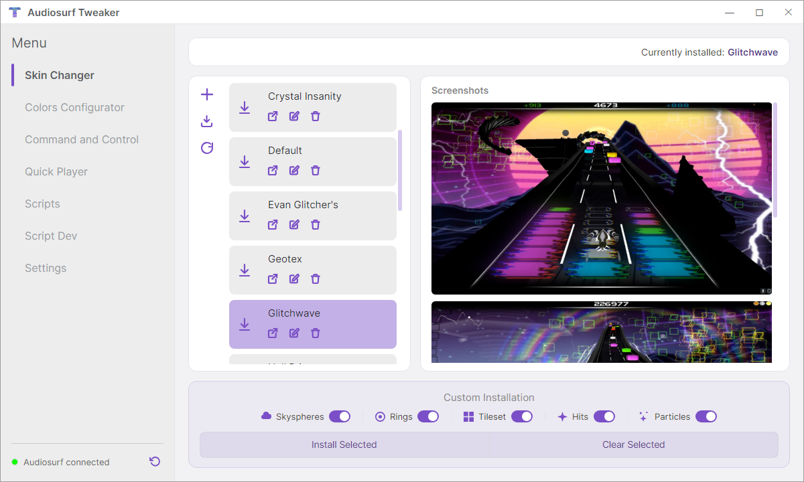
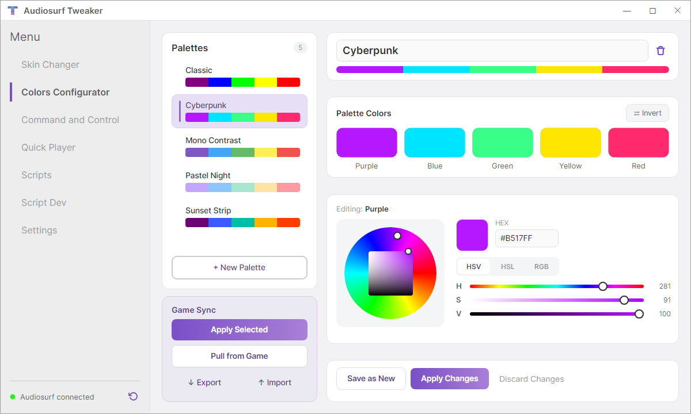
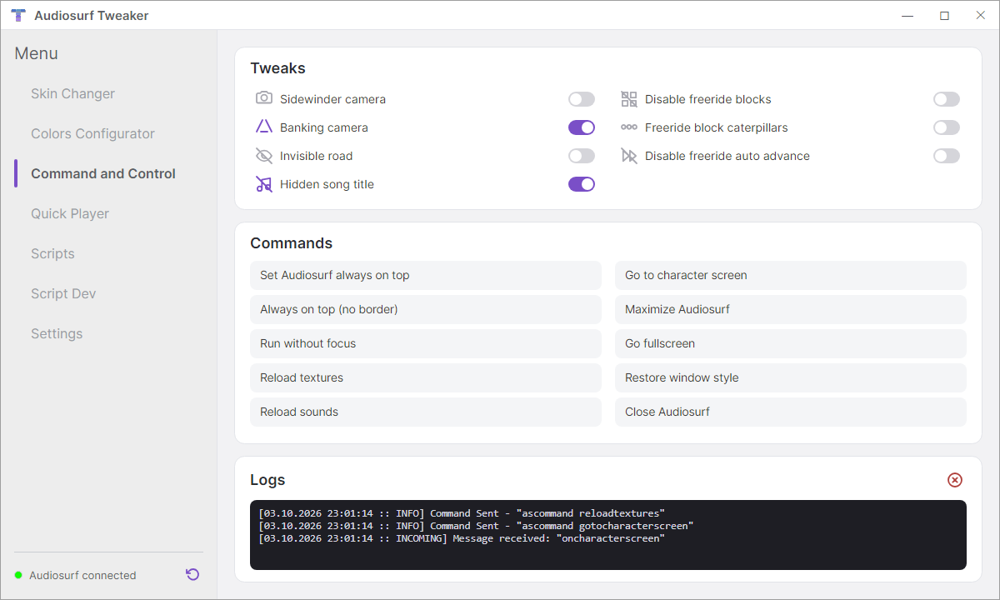
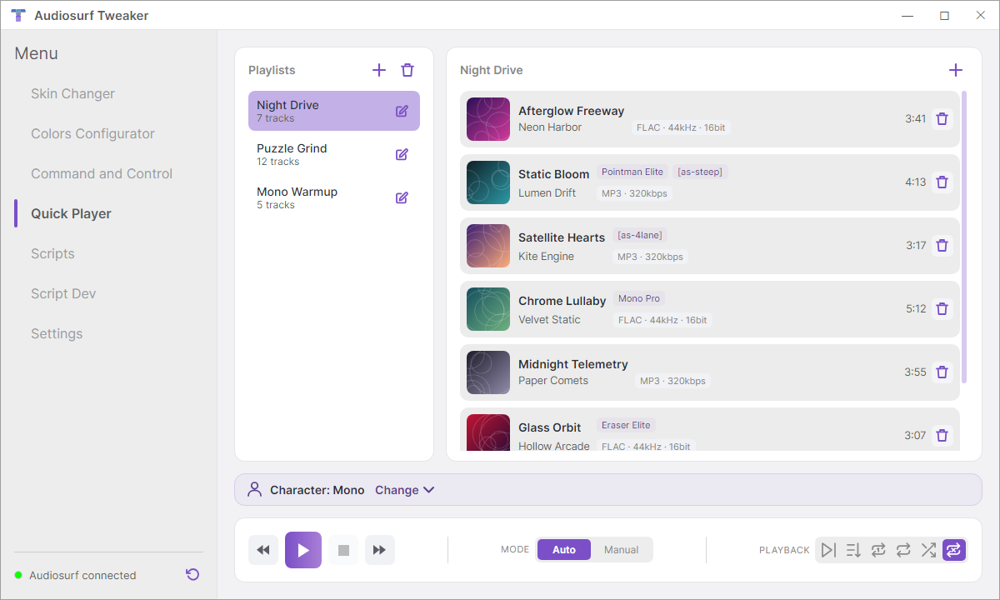
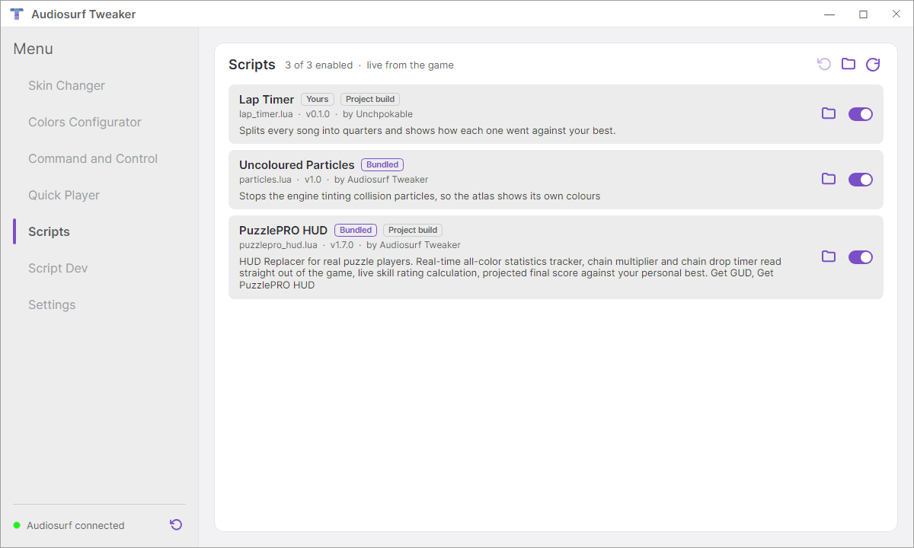
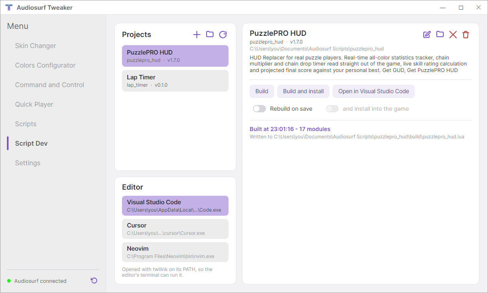
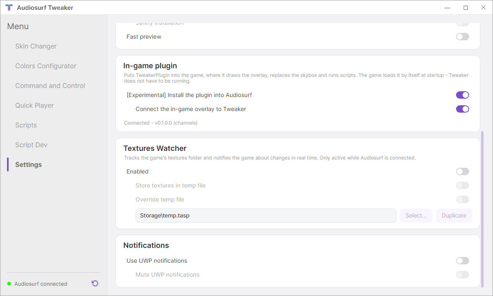

<div align="center">

# Audiosurf Tweaker

**Skins, colours, playlists, custom skies and Lua scripting for [Audiosurf](https://store.steampowered.com/app/12900/AudioSurf/).**

[](https://github.com/Unchpokable/Audiosurf-Tweaker/releases)
[](LICENSE)


<picture>
  <source media="(prefers-color-scheme: dark)" srcset="Docs/readme/skin-changer-dark.png">
  
</picture>

</div>

Audiosurf Tweaker comes in two parts:

- **The Tweaker**, a desktop app. It manages your texture packs and colour palettes, runs playlists that
  start each song in the game for you, and switches the game's hidden settings while it runs.
- **The in-game plugin**, which Audiosurf loads at startup. It draws an overlay menu inside the game, replaces
  the sky with one of your own, and runs Lua scripts that read the game's live state and draw over it. It
  works on its own: the Tweaker doesn't have to be running.

You don't need to know any of the internals to use either. If you want to make something for it, there is
a full manual for [scripts](Docs/scripting.md) and one for [skies](Docs/skyboxes.md).

## Contents

- [Getting started](#getting-started)
- [Features](#features)
  - [Skin Changer](#skin-changer)
  - [Colors Configurator](#colors-configurator)
  - [Command and Control](#command-and-control)
  - [Quick Player](#quick-player)
  - [The in-game overlay](#the-in-game-overlay)
  - [Skybox Replacer](#skybox-replacer)
  - [Lua scripts](#lua-scripts)
  - [Script Dev](#script-dev)
- [How it works](#how-it-works)
- [Troubleshooting](#troubleshooting)
- [Documentation](#documentation)
- [Building from source](#building-from-source)
- [Credits](#credits)

## Getting started

**You need** Windows 10 or 11 (64-bit) and Audiosurf (the original 2008 game from Steam). The release
includes its own .NET runtime, so there is nothing else to install.

1. Download the latest `.zip` from the [Releases page](https://github.com/Unchpokable/Audiosurf-Tweaker/releases).
2. Extract it into any folder. Keep everything in it together: the Tweaker uses the helper programs and
   folders it ships with.
3. Run `TweakerUI.exe`. On first launch it finds your Steam copy of Audiosurf. If it can't, set the path to
   `Audiosurf\engine\textures` under **Settings → Paths**.
4. *(Optional)* Under **Settings → In-game plugin**, switch on **Install the plugin into Audiosurf**. The next
   time you start the game, press <kbd>Insert</kbd> to open the overlay.

**Coming from an older version?** Skins and palettes saved by older Tweakers (`.askin2`, the binary `.tasp`,
`.pltc`) are converted automatically the first time they are opened.

## Features

### Skin Changer

<picture>
  <source media="(prefers-color-scheme: dark)" srcset="Docs/readme/skin-changer-dark.png">
  
</picture>

Keep any number of texture packs and switch between them with one click.

- **Install all of a skin or only some of it:** skyspheres, rings, tileset, hits and particles can each be
  switched off, so you can take one skin's rings and another's sky.
- **Import from the game:** save whatever is in the game's textures folder right now as a new skin.
- **Share skins.** A skin is one `.tasp` file holding the textures, their screenshots and a manifest. Export it,
  send it, and the other player adds it with **+**.
- **Hot reload:** the game picks up the new textures straight away, with no restart.
- **Don't lose unsaved work:** if the textures in the game aren't saved as a skin yet, **folder control** asks
  before a skin overwrites them, and **safety installation** refuses until you save them.

Drawing your own skin: [**How to make texture packs for Audiosurf**](Docs/texturing.md).

### Colors Configurator

<picture>
  <source media="(prefers-color-scheme: dark)" srcset="Docs/readme/colors-dark.png">
  
</picture>

Audiosurf gives you RGB sliders for its five block colours. This tab gives you a colour wheel, HSV/HSL/RGB
sliders and hex input instead. Save any number of palettes and send one to the game with **Apply Selected**.
**Pull from Game** reads back the colours the game is using now, and palettes can be exported and imported
to share.

### Command and Control

<picture>
  <source media="(prefers-color-scheme: dark)" srcset="Docs/readme/command-and-control-dark.png">
  
</picture>

Settings Audiosurf has but doesn't show you, switched on and off while the game runs:

| Tweak | What it does |
|---|---|
| **Invisible road** | Hides the track surface: only the blocks are left. |
| **Hidden song title** | Hides the song name at the start of a ride. |
| **Banking camera**, **Sidewinder camera** | The game's alternative camera modes. |
| **Disable freeride blocks**, **Freeride block caterpillars**, **Disable freeride auto advance** | Freeride mode, your way. |

There are also one-click window commands (always on top, borderless, fullscreen, run without focus), commands
to reload textures and sounds without restarting, and a log of everything sent to the game and everything it
sent back.

### Quick Player

<picture>
  <source media="(prefers-color-scheme: dark)" srcset="Docs/readme/quick-player-dark.png">
  
</picture>

Playlists for Audiosurf. Add your tracks once and press play: each song starts in the game on its own, and
the next one follows when you finish.

- **Per-track settings.** Each track can have its own character (Pointman Elite on one song, Mono Pro on the
  next), its own song tags (`[as-steep]`, `[as-4lane]`, `[as-portal]` and the rest of Audiosurf's title tags),
  and its own tweaks. Those apply only while that track plays and are put back afterwards. Your files are
  never edited.
- **Six playback modes:** in order, single track, shuffle, repeat one, repeat all and endless shuffle.
- **Auto or Manual advance:** start the next song as soon as the ride ends, or wait until you've read your
  score and left the results screen.
- Album art, track length and format are read from your files. FLAC, MP3 and the other formats Audiosurf plays
  are supported.
- The overlay has a **Player** tab too, so you can pick playlists and tracks without leaving the game.

### The in-game overlay

Press <kbd>Insert</kbd> in the game to open a menu drawn inside the game itself:

| Tab | |
|---|---|
| **Skins** | Install a skin from your Skin Changer library, mid-session. |
| **Tweaks** | The same switches as Command and Control. |
| **Player** | Quick Player: playlists, tracks, play / stop / next, playback mode. |
| **Skybox** | Pick a sky and tune it live (see below). |
| **Scripts** | Every installed script with its state, cost and messages, a switch for each, and Resume for one that was paused. |
| **Settings** | Where the overlay's notices and pins sit, and its colour theme. |

Skybox and Scripts work without the Tweaker. Skins, Tweaks and Player need it running, and show an
**Offline** pin when it isn't. The overlay and the Tweaker stay in sync both ways: a switch flipped in one
moves in the other.

### Skybox Replacer

Swap the game's sky for one of your own. A sky can be:

- **a picture**: a cube map or six square images, with no setup needed;
- **a shader**: an HLSL program that computes the sky for every pixel. It stays sharp at any resolution, can
  move, and can **react to the music that's playing**;
- **a sky package**: a `.sky` folder (or the same folder as a single zip) with layered shaders, textures,
  sprite clouds placed by Lua, its own lights, and sliders that appear in the overlay so you can tweak the
  sky mid-ride. Packages reload as soon as you save a file.

The plugin ships with two sky packages. To make your own, start with
[**Making skies for Audiosurf**](Docs/skyboxes.md).

### Lua scripts

<picture>
  <source media="(prefers-color-scheme: dark)" srcset="Docs/readme/scripts-dark.png">
  
</picture>

Scripts run inside the game. A script can read the live state of a ride (score, the track ahead, the blocks
you've collected), draw its own HUD over the game, react the moment something happens, and switch parts of
the game's own behaviour off. A script is a text file: put it in a folder and it runs, with no rebuild.

Two scripts ship with the plugin:

- **PuzzlePRO HUD** replaces the HUD for puzzle players. It shows real-time statistics for every colour, the
  chain multiplier and chain drop timer read straight from the game, a live skill rating, and your projected
  final score against your personal best.
- **Uncoloured Particles** stops the game tinting block particles, so a particle texture shows its own
  colours. That means texture packs can finally ship coloured particles.

Scripts are kept on a short leash. They don't start until the game has finished loading. One that keeps
failing, or slows the game down, is paused on its own, and the others keep running. Errors point at the line
in your own file.

The **Scripts** tab in the Tweaker lists what's installed in the game. If the game is running, it shows
what each script is doing and switches them there and then. It can also put back any shipped script you've
edited or deleted.

**Write your own:** [**Scripting Audiosurf with Audiosurf Tweaker**](Docs/scripting.md), the full manual,
from your first script to the API reference.

### Script Dev

<picture>
  <source media="(prefers-color-scheme: dark)" srcset="Docs/readme/script-dev-dark.png">
  
</picture>

For scripts too big for one file. A **project** is a folder of Lua modules joined with `require`.
`twllink`, the linker that ships with the Tweaker, builds it into the single file the game runs (PuzzlePRO HUD
is 17 modules).

- Create a project from a template, build it, and install it into the game in one click. If the game is
  running, it reloads the script there and then.
- **Rebuild on save:** keep your editor open, and every save rebuilds and, if you want, reinstalls.
- Errors are caught at build time: unknown API names, sandbox violations, missing modules. Each one points at
  the file and line in your project. A runtime error in the game points back at your module too, not at the
  built file.
- Projects open in Visual Studio Code, Cursor, Sublime Text, Notepad++, Vim or Neovim, with `twllink` on the
  editor's `PATH`. Projects come with API definitions for the Lua language server, so completion and
  hover-docs work out of the box.

`twllink` also works on its own from the command line. See
[Projects: scripts made of many files](Docs/scripting/authoring.md).

<details>
<summary><b>Settings</b></summary>
<br>

<picture>
  <source media="(prefers-color-scheme: dark)" srcset="Docs/readme/settings-dark.png">
  
</picture>

Light and dark theme, the game and extra skins folders, Skin Changer behaviour, installing and updating the
in-game plugin, the textures watcher (tells the game about texture changes as they happen), and Windows
notifications.

</details>

## How it works

Audiosurf has a debug protocol built in: a running game accepts commands and settings from another program,
and reports back what it's doing. The Tweaker uses that protocol. It doesn't patch the game or touch its
memory, which is why skins, palettes, tweaks and playlists all work on an unmodified copy of Audiosurf.

The plugin is different, because drawing inside the game needs code inside the game. Audiosurf runs on the
Quest3D engine, which at startup loads every DLL in its `engine\channels\` folder. Installing the plugin puts
it there, so the game loads it itself and no injection is involved. The plugin keeps everything else in one
folder, `engine\TweakerStuff\`: settings, scripts, skies and logs. Switching the plugin off in Settings
removes it cleanly.

Nothing the Tweaker or a script does is uploaded anywhere. Leaderboards get the score the game itself
reports, not anything a script draws.

## Troubleshooting

- **"Audiosurf not connected"**: start the game first, or press the reset button next to the status in the
  bottom left corner.
- **The game crashes or misbehaves at startup with the plugin installed**: create an empty file named
  `DISABLE` (no extension) in `Audiosurf\engine\TweakerStuff\`. The plugin will then load but do nothing.
  Its log, `engine\TweakerStuff\Logs\TweakerPlugin.log`, records what happened even when the game closes
  before its window appears. Please attach it to an [issue](https://github.com/Unchpokable/Audiosurf-Tweaker/issues).
- **A script stopped working**: open the overlay's **Scripts** tab. Its message says why the script was
  paused, and **Resume** starts it again.

## Documentation

| | |
|---|---|
| [**Scripting manual**](Docs/scripting.md) | Lua scripts: how the game is built, channels, hooks, drawing, projects, the full API reference. |
| [**Sky manual**](Docs/skyboxes.md) | `.sky` packages: the manifest, shaders, music reactivity, clouds, cost and limits. |
| [**Texture packs**](Docs/texturing.md) | What each of the game's textures is for and how to draw them. |
| [`Docs/Internal/`](Docs/Internal/) | The developers' working notes: architecture, protocols, and the reverse-engineering journals of the game. They are in Russian and rougher than the manuals, but they are where the map of the game's internals lives. |

## Building from source

The desktop side is .NET 10. Building it also builds `asbridge.exe` and the injector, so you need:

- the [.NET 10 SDK](https://dotnet.microsoft.com/download);
- Visual Studio 2022 or later with the **Desktop development with C++** workload, and CMake.

```
git clone --recurse-submodules https://github.com/Unchpokable/Audiosurf-Tweaker.git
dotnet build TweakerUI/TweakerUI.csproj
dotnet run --project TweakerUI/TweakerUI.csproj
```

Two projects need the full Visual Studio MSBuild rather than `dotnet build`: `LegacyDataConverter` (the
converter for old skins, which stays on .NET Framework) and `Installer`. The deploy scripts build them that way.

The in-game plugin (`TweakerPlugin/`) is an x86 C++23 DLL. It also needs the DirectX SDK (June 2010) and
Dear ImGui, plus the Quest3D SDK, which is proprietary and not part of this repository. Without them the
plugin is skipped with a warning and everything else still builds. Release bundles are produced by
`Scripts/Deploy.ps1` (or `Deploy.sh` in Git Bash).

Tests are NUnit, one project per library: `dotnet test TweakerCore.Tests/TweakerCore.Tests.csproj` and so
on. `Tools/UiStand/` renders the app's real views offscreen. That is how the screenshots on this page are
made (`UiStand.exe readme <dir>`).

## Credits

Audiosurf is made by Dylan Fitterer. Audiosurf Tweaker is a fan project and is not affiliated with him or
with Valve.

Audiosurf Tweaker is built on:

| | |
|---|---|
| [Avalonia](https://avaloniaui.net/), [CommunityToolkit.Mvvm](https://github.com/CommunityToolkit/dotnet), [SkiaSharp](https://github.com/mono/SkiaSharp) | the desktop UI |
| [TagLib#](https://github.com/mono/taglib-sharp) | reading audio files and their tags |
| [Gameloop.Vdf](https://github.com/shravan2x/Gameloop.Vdf) | finding the game in your Steam libraries |
| [Loretta](https://github.com/LorettaDevs/Loretta) | parsing Lua in `twllink` |
| [Dear ImGui](https://github.com/ocornut/imgui) | the in-game overlay |
| [Microsoft Detours](https://github.com/microsoft/Detours) | hooking into the game's renderer and engine |
| [LuaJIT](https://luajit.org/) | running scripts in the game |
| [LunaSVG](https://github.com/sammycage/lunasvg) and [plutovg](https://github.com/sammycage/plutovg) | the overlay's icons |
| [yyjson](https://github.com/ibireme/yyjson), [miniz](https://github.com/richgel999/miniz) | sky package manifests and zipped packages |
| [stb](https://github.com/nothings/stb), [Tweeny](https://github.com/mobius3/tweeny) | images and overlay animations |

Each library is used under its own license.

Audiosurf Tweaker itself is released under the [MIT License](LICENSE).
